# Lab 01: Rede local básica

Laboratório feito no Cisco Packet Tracer. Uma rede pequena com 1 switch e 4 PCs, usada para praticar endereçamento IP, testes de conectividade (ping) e para observar, no modo Simulation, como o ARP e o ICMP funcionam. No final, um desafio extra mostra o que acontece quando dois PCs estão em redes IP diferentes.

## Objetivo

- Montar uma rede local com 1 switch e 4 PCs.
- Configurar endereços IP estáticos e verificar a comunicação entre os PCs.
- Acompanhar um ping passo a passo no modo Simulation e entender as camadas envolvidas (Ethernet, IP e ICMP).
- Observar o ARP descobrindo o endereço físico (MAC) de um destino.
- Entender por que PCs em redes diferentes não se comunicam só com um switch.

## Topologia

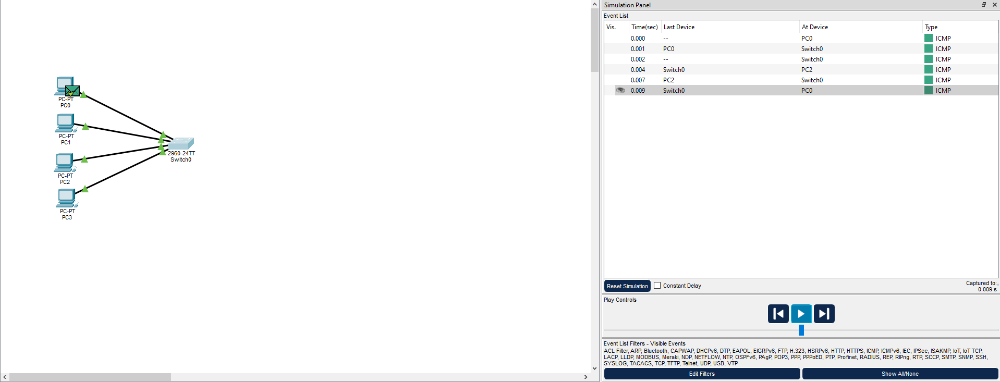

| Item | Detalhe |
| --- | --- |
| Switch | 1 × Cisco 2960-24TT (Switch0) |
| PCs | 4 × PC-PT (PC0 a PC3) |
| Cabos | Copper Straight-Through, de cada PC ao switch |

## Tabela de endereçamento

Todos os dispositivos estão na mesma rede (`192.168.1.0/24`), então nenhum gateway é necessário.

| Dispositivo | Endereço IP | Máscara | Endereço MAC |
| --- | --- | --- | --- |
| PC0 | 192.168.1.10 | 255.255.255.0 | 0010.116A.AB93 |
| PC1 | 192.168.1.11 | 255.255.255.0 | 00D0.BCE1.72E4 |
| PC2 | 192.168.1.12 | 255.255.255.0 | 0009.7CB8.A454 |
| PC3 | 192.168.1.13 | 255.255.255.0 | 0050.0F54.A378 |

Os MACs foram lidos dos próprios pacotes capturados no modo Simulation (veja a seção de testes).

## Configurações feitas

IP estático em cada PC, em Desktop → IP Configuration, conforme a tabela acima.

## Testes realizados

### 1. Ping entre PC0 e PC2

No modo Simulation, com o filtro de eventos só em ICMP, o ping foi e voltou: PC0 → Switch0 → PC2 → Switch0 → PC0. O visto verde no envelope indica que o pacote chegou.

### 2. Camadas do pacote

Abrindo o pacote no PC0, dá para ver cada camada:

| Sentido | Camada 2 (Ethernet) | Camada 3 (IP) |
| --- | --- | --- |
| Ida | `0010.116A.AB93` → `0009.7CB8.A454` | 192.168.1.10 → 192.168.1.12, ICMP tipo 8 (Echo Request) |
| Volta | `0009.7CB8.A454` → `0010.116A.AB93` | 192.168.1.12 → 192.168.1.10, ICMP tipo 0 (Echo Reply) |

Na ida, o PC0 montou o ICMP Echo Request, encapsulou em um quadro Ethernet e já tinha o MAC do destino na tabela ARP. Na volta, origem e destino aparecem trocados, tanto no IP quanto no MAC.

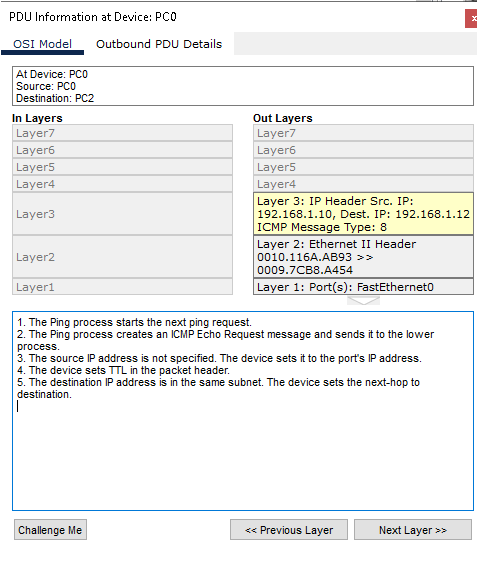
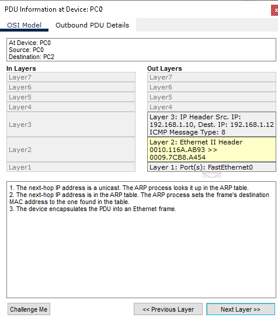
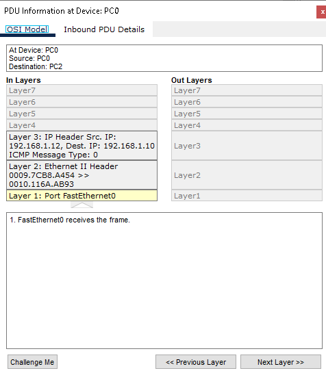

### 3. ARP entre PC1 e PC3

Entre PC0 e PC2 não apareceu ARP, porque o PC0 já conhecia o MAC do PC2. Para ver o ARP, limpei a tabela do PC1 com `arp -d` e mandei um ping do PC1 para o PC3.

Sequência observada na Event List:

1. O PC1 envia um **ARP Request** em broadcast (destino `FFFF.FFFF.FFFF`) perguntando quem tem o IP 192.168.1.13.
2. O switch repassa o pedido para os outros PCs. Só o PC3 responde.
3. O PC3 envia o **ARP Reply** direto para o MAC do PC1 (unicast).
4. Só depois disso o ping (ICMP) acontece, e a linha PC1 → PC3 aparece como Successful.

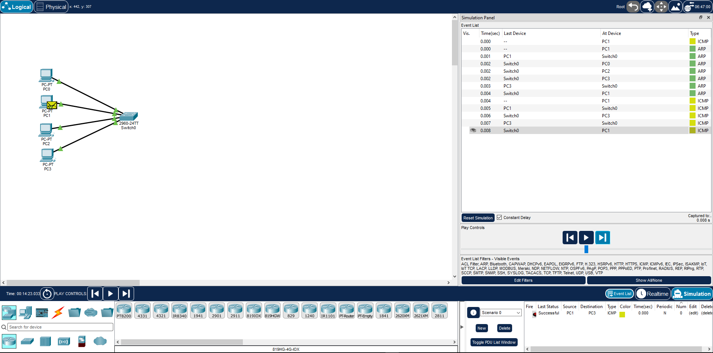
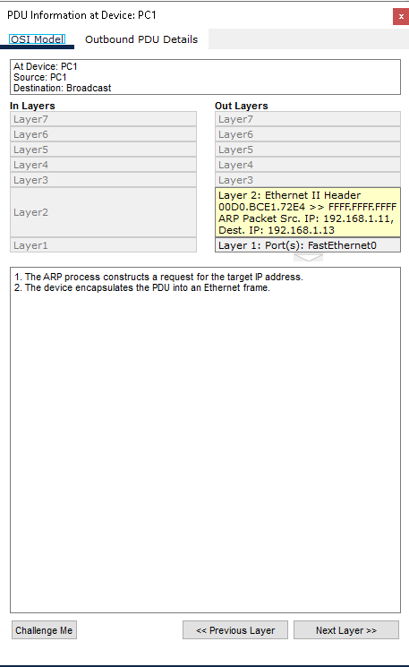
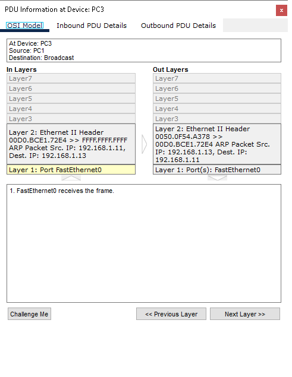

Tabela ARP do PC1: o `arp -d` limpa a tabela (`No ARP Entries Found`) e, depois do ping, o PC3 aparece com o MAC dele.

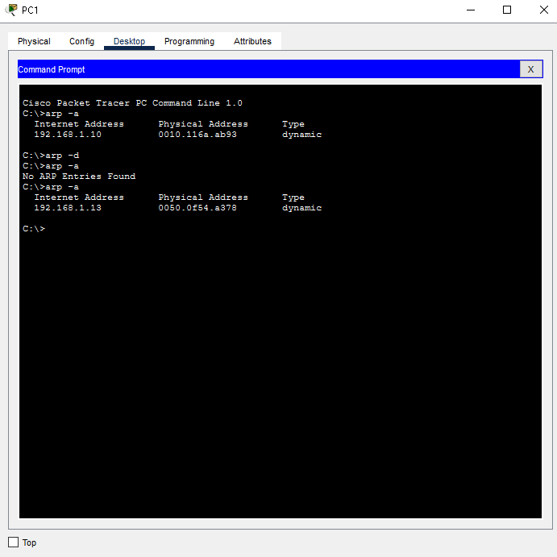

### 4. Desafio extra: PC em outra rede

Mudei o IP do PC3 para `192.168.2.13`, com máscara `255.255.255.0` e **sem gateway**, e testei a partir do PC0.

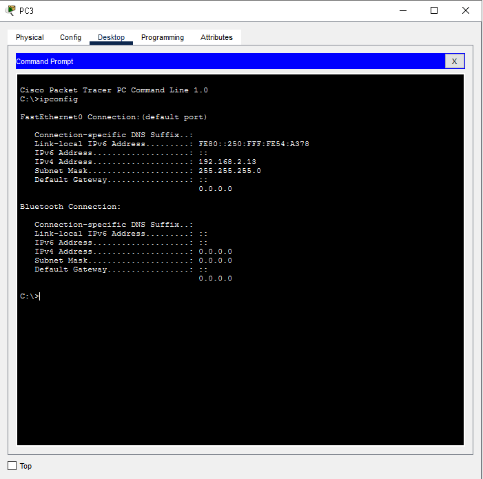

| Ping a partir do PC0 | Rede do destino | Resultado |
| --- | --- | --- |
| `ping 192.168.1.13` | Mesma rede do PC0 | 4 respostas, 0% de perda |
| `ping 192.168.2.13` | Outra rede | `Request timed out` nas 4 tentativas, 100% de perda |

No print, o primeiro e o último ping são para `192.168.2.13` (falham); o do meio, para `192.168.1.13`, foi feito com o PC3 de volta no IP original e funcionou.

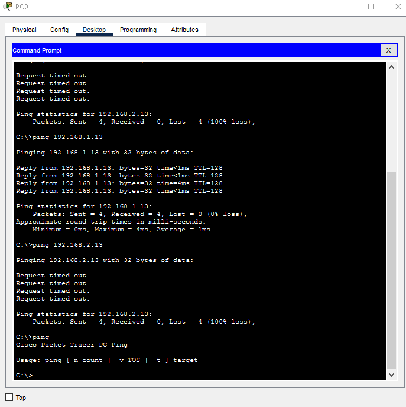

**Por que falhou:**

- O PC0 tem IP `192.168.1.10` com máscara `255.255.255.0`, então considera "da minha rede" só os endereços `192.168.1.x`. O `192.168.2.13` está fora dessa faixa.
- Para falar com outra rede, o PC precisa mandar o pacote para um gateway (um roteador). Os PCs deste laboratório não têm gateway configurado (o `ipconfig` do PC3 mostra o Default Gateway vazio).
- O switch 2960 trabalha na camada 2 (Ethernet): ele só encaminha quadros dentro da mesma rede, e não faz roteamento entre redes IP diferentes.
- Por isso o ping expira, mesmo com cabos e switch funcionando, como mostra o ping para `192.168.1.13`, que na mesma rede funcionou.
- Para funcionar, seria preciso um **roteador** entre as duas redes e o **gateway** configurado em cada PC. Isso fica para o Lab 03.

Depois do teste, voltei o PC3 para `192.168.1.13`.

## Problemas encontrados e como resolvi

| Problema | Causa | Solução |
| --- | --- | --- |
| A Event List do Simulation se encheu de pacotes que não eram o ping | O switch envia pacotes de fundo por conta própria: STP (a cada 2 segundos, para checar loops) e DTP (negociação de trunk) | Abri Edit Filters e deixei visíveis só ARP e ICMP |
| Dois pings apareciam ao mesmo tempo na lista | Cliquei duas vezes no botão Fire da janela de PDUs | Reset Simulation e Fire uma vez só |
| O ARP não aparecia no ping entre PC0 e PC2 | O PC0 já tinha o MAC do PC2 na tabela ARP, e o Reset Simulation só limpa os eventos, não a tabela | Usei `arp -d` e um par de PCs que ainda não tinham conversado (PC1 e PC3) |
| Os PCs aparecem como PC0 a PC3, e não PC1 a PC4 | O Packet Tracer numera a partir de 0 | Usei os nomes que aparecem na tela em todo o relatório |

Tráfego de fundo do switch (STP), antes de aplicar o filtro:

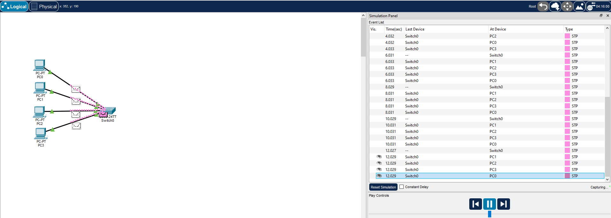

## Conclusão

- Em uma mesma rede, o ping funciona entre os PCs sem roteador, usando só o switch.
- O ping é um ICMP Echo Request (tipo 8) respondido por um Echo Reply (tipo 0), encapsulado em IP e depois em Ethernet.
- Antes de enviar um quadro, o PC precisa do MAC do destino. Se não tem na tabela ARP, pergunta em broadcast e só o dono do IP responde.
- O switch gera tráfego próprio (STP e DTP), e filtrar a Event List é necessário para enxergar o que interessa.
- PCs em redes IP diferentes só se comunicam por meio de um roteador, e cada PC precisa saber o gateway.

## Arquivos

| Arquivo | Descrição |
| --- | --- |
| `lab01-rede-basica.pkt` | Arquivo do Packet Tracer |
| `img/` | Prints usados neste relatório |
