# Lab 02: VLANs e trunk

Laboratório feito no Cisco Packet Tracer. Dois switches e quatro PCs, com a rede dividida em duas VLANs (VENDAS e TI) que atravessam os dois switches por um link trunk. O foco é entender o que a VLAN separa, para que serve o trunk e qual é a regra para dois PCs conversarem sem roteador.

## Objetivo

- Criar VLANs em dois switches e colocar as portas dos PCs em cada VLAN (portas access).
- Configurar um link trunk entre os switches e verificar com `show vlan brief` e `show interfaces trunk`.
- Testar quem conversa com quem, com e sem o trunk.
- Observar no modo Simulation o quadro ser marcado com 802.1Q (Dot1q) ao passar pelo trunk.
- Entender a regra: para dois PCs se comunicarem sem roteador, precisam estar na **mesma sub-rede e na mesma VLAN**.

## Topologia

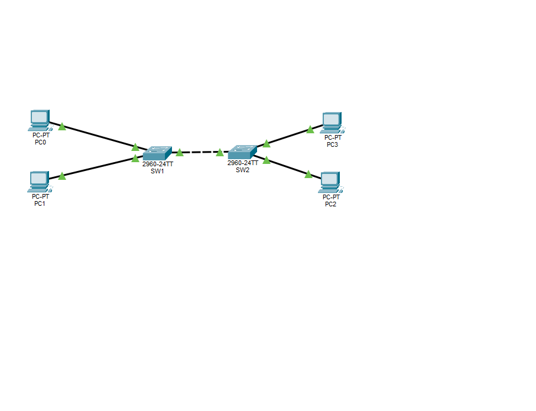

| Item | Detalhe |
| --- | --- |
| Switches | 2 × Cisco 2960-24TT (SW1 e SW2) |
| PCs | 4 × PC-PT (PC0 a PC3) |
| Cabos PC ↔ switch | Copper Straight-Through |
| Cabo entre os switches | Copper Cross-Over (Gi0/1 ↔ Gi0/1), configurado como trunk |

## Tabela de endereçamento e VLANs

Nenhum gateway foi configurado, porque não há roteador neste laboratório.

| Dispositivo | Porta do switch | VLAN | Endereço IP | Máscara |
| --- | --- | --- | --- | --- |
| PC0 | SW1 Fa0/1 | 10 (VENDAS) | 192.168.10.10 | 255.255.255.0 |
| PC1 | SW1 Fa0/2 | 20 (TI) | 192.168.20.10 | 255.255.255.0 |
| PC2 | SW2 Fa0/1 | 10 (VENDAS) | 192.168.10.11 | 255.255.255.0 |
| PC3 | SW2 Fa0/2 | 20 (TI) | 192.168.20.11 | 255.255.255.0 |

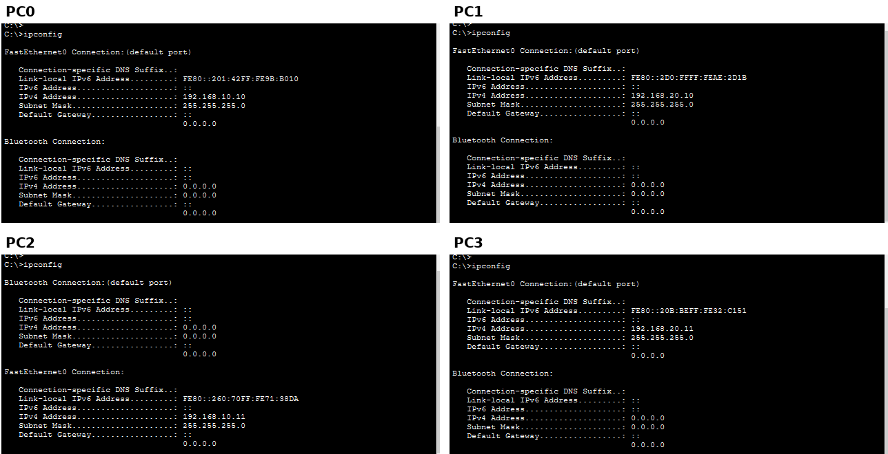

## Configurações feitas

Em **cada** switch (as VLANs são locais de cada switch, então precisam existir nos dois). No SW2, trocar o hostname para `SW2`:

```
enable
configure terminal
hostname SW1
vlan 10
name VENDAS
vlan 20
name TI
exit
interface fastEthernet 0/1
switchport mode access
switchport access vlan 10
exit
interface fastEthernet 0/2
switchport mode access
switchport access vlan 20
end
write memory
```

Trunk, nos dois switches:

```
configure terminal
interface gigabitEthernet 0/1
switchport mode trunk
end
write memory
```

Verificação das VLANs e das portas no SW1 e no SW2:

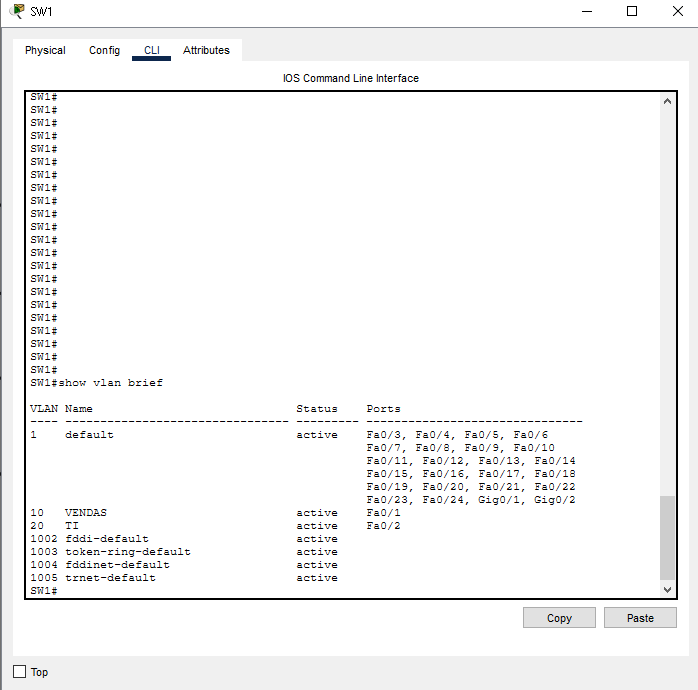
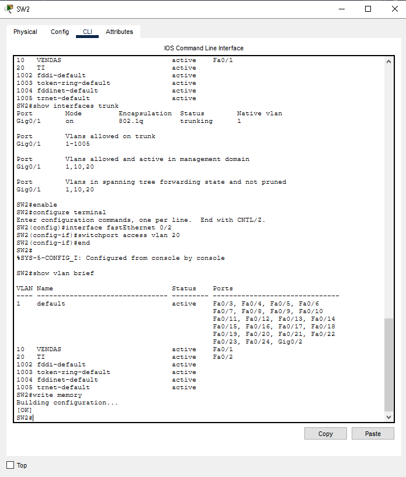

Verificação do trunk no SW1: `Gig0/1` em modo `on`, encapsulamento `802.1q`, status `trunking`, e as VLANs `1,10,20` listadas em "active in management domain".

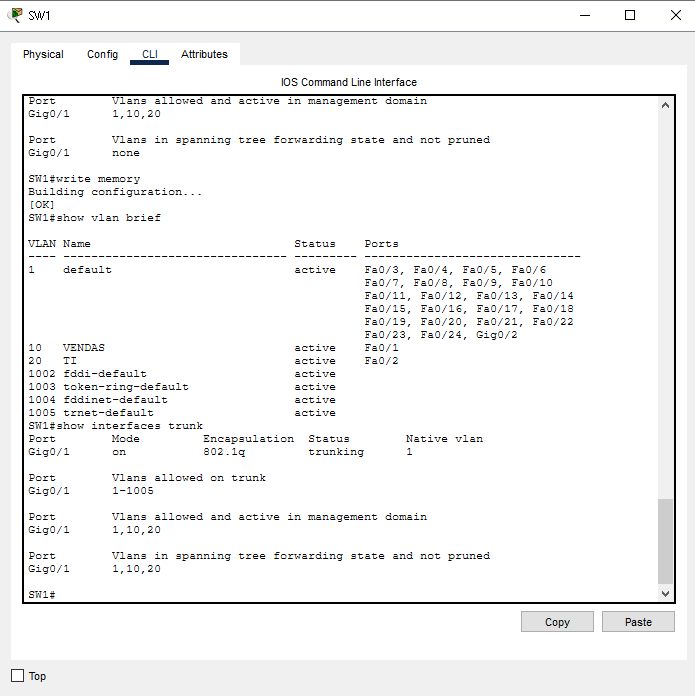

## Testes realizados

### 1. Pings com o trunk ativo

| Origem | Destino | VLAN da origem / destino | Resultado |
| --- | --- | --- | --- |
| PC0 (192.168.10.10) | PC2 (192.168.10.11) | 10 / 10 | 4 respostas, 0% de perda |
| PC0 | PC1 (192.168.20.10) | 10 / 20 | 100% de perda |
| PC0 | PC3 (192.168.20.11) | 10 / 20 | 100% de perda |
| PC1 (192.168.20.10) | PC3 (192.168.20.11) | 20 / 20 | 4 respostas, 0% de perda |
| PC1 | PC0 (192.168.10.10) | 20 / 10 | 100% de perda |

PCs da mesma VLAN conversam, mesmo em switches diferentes (graças ao trunk). PCs de VLANs diferentes não conversam.

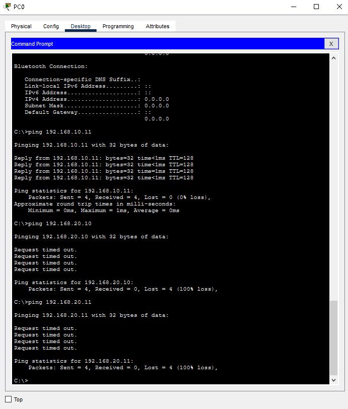
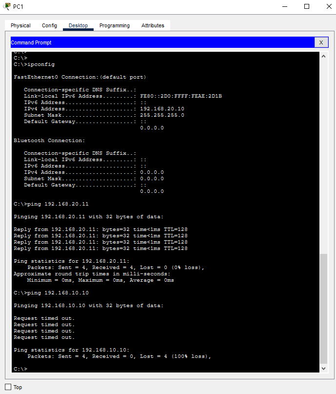

### 2. Sem o trunk

Para mostrar o papel do trunk, troquei a Gi0/1 dos dois switches para `switchport mode access` e testei de novo. O ping do PC0 para o PC2 (mesma VLAN 10, mas em switches diferentes), que funcionava, passou a falhar. Em seguida voltei as duas portas para `switchport mode trunk`.

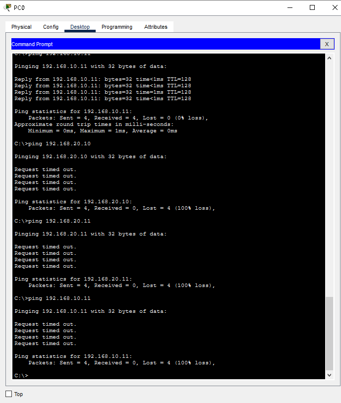

Comandos usados (e o resultado ao voltar para trunk):

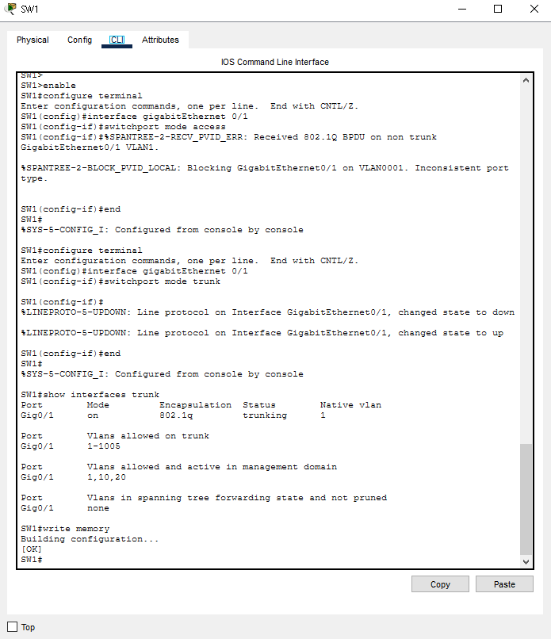
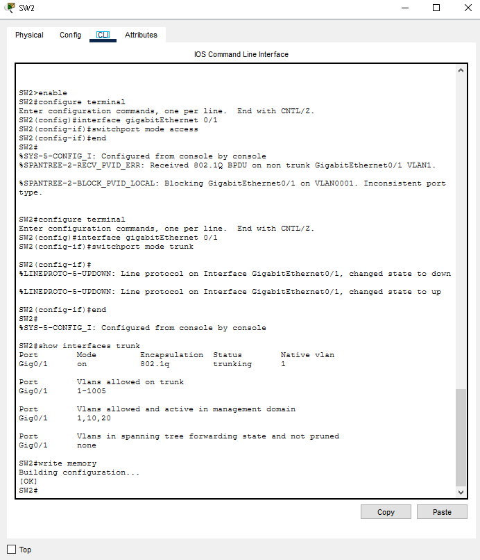

Ao deixar a porta como access, o próprio switch avisou da inconsistência (`%SPANTREE-2-RECV_PVID_ERR` e `%SPANTREE-2-BLOCK_PVID_LOCAL`): um lado recebeu um BPDU 802.1Q numa porta que não era trunk e bloqueou a porta.

### 3. Modo Simulation: o que o trunk faz com o quadro

Com o filtro em ARP e ICMP, mandei um ping do PC0 para o PC2. O ARP em broadcast sai do PC0, passa pelo SW1, atravessa o trunk, passa pelo SW2 e chega só ao PC2 (que está na VLAN 10). O ICMP vem em seguida.

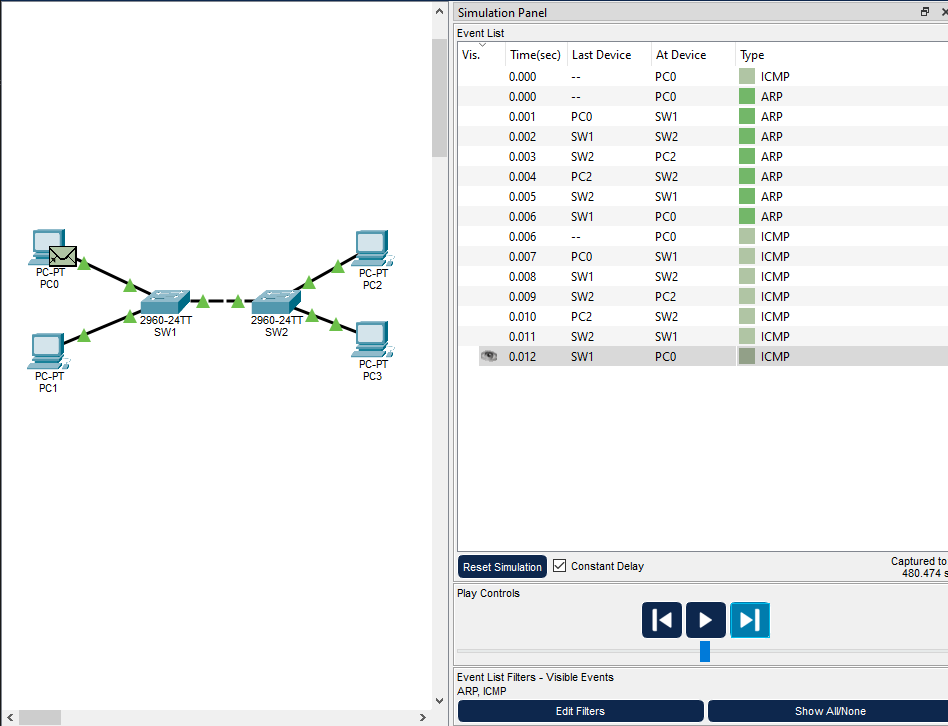

Abrindo o pacote no SW2, a camada 2 de entrada (pela Gi0/1, o trunk) aparece como **Dot1q Header**, e a de saída (pela Fa0/1, porta access) como **Ethernet II Header**. Ou seja, o quadro viaja marcado com a VLAN no trunk e a marca é removida ao sair para o PC.

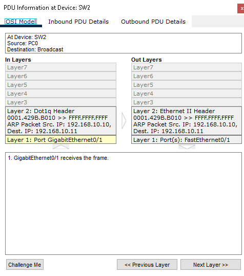

Em Inbound PDU Details aparece o quadro `Ethernet 802.1q`, com destino `FFFF.FFFF.FFFF` (broadcast) e o ARP perguntando pelo IP 192.168.10.11.

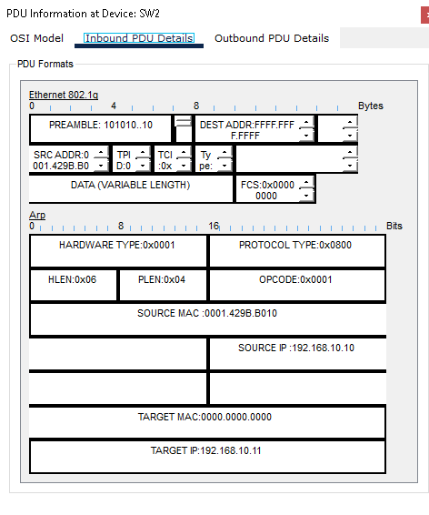

### 4. Desafio extra A: mesma VLAN, mesma sub-rede, outro PC

Coloquei a porta do PC1 (SW1 Fa0/2) na VLAN 10 com `switchport access vlan 10` e dei ao PC1 o IP `192.168.10.12`. Agora PC0 e PC1 estão na mesma VLAN e na mesma sub-rede.

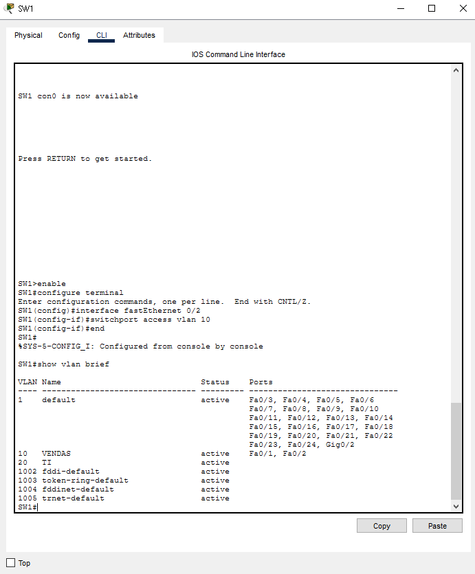

Os dois primeiros pings do PC0 para `192.168.10.12` falharam, e o terceiro funcionou (0% de perda). A explicação provável é que, logo depois de mudar a VLAN da porta, o link ainda estava em convergência do STP (luz laranja por cerca de 30 segundos) e não encaminhava tráfego. Passado esse tempo, funcionou.

### 5. Desafio extra B: mesma sub-rede, VLANs diferentes

Com o PC3 (VLAN 20) usando o IP `192.168.10.50`, na **mesma sub-rede** do PC0, o ping do PC0 para `192.168.10.50` falhou com 100% de perda.

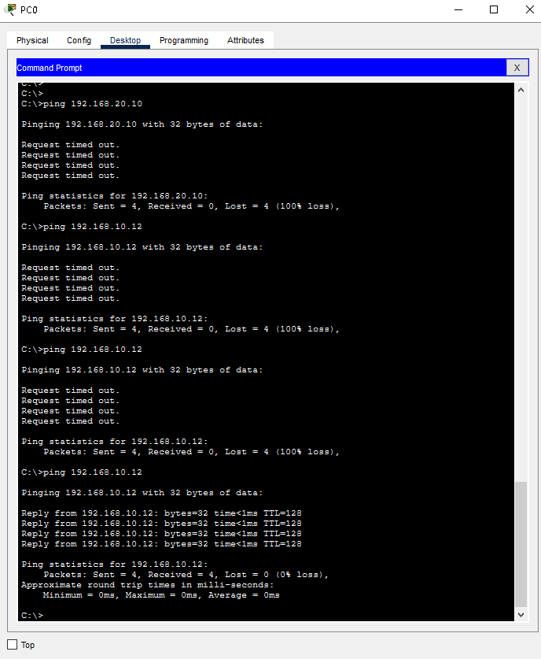
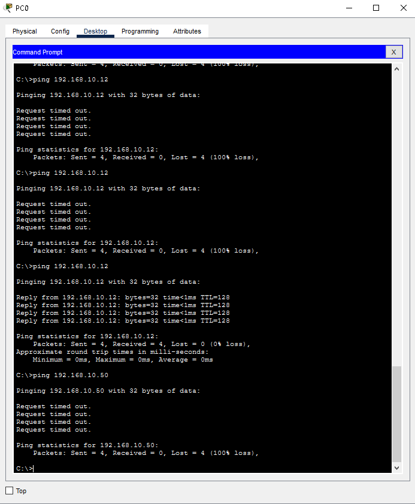

Como o IP está na sub-rede do PC0, ele envia o ARP em broadcast. Mas o broadcast fica restrito à VLAN 10 e nunca chega ao PC3, que está na VLAN 20. Sem resposta ao ARP, não há ping.

### A regra

| Sub-rede | VLAN | Resultado |
| --- | --- | --- |
| Igual | Igual | Funciona (com trunk, mesmo em switches diferentes) |
| Igual | Diferente | Falha: o ARP em broadcast não chega ao destino |
| Diferente | Igual | Falha: sem gateway, o PC nem tenta falar com o destino |
| Diferente | Diferente | Falha (só funcionaria com um roteador, Lab 03) |

A **sub-rede** decide se o PC chega a perguntar (ARP); a **VLAN** decide quem ouve a pergunta.

## Problemas encontrados e como resolvi

| Problema | Causa | Solução |
| --- | --- | --- |
| PC2 e PC3 estavam ligados ao SW1, e não ao SW2 | Erro na montagem dos cabos | Religuei PC2 e PC3 no SW2 (Fa0/1 e Fa0/2) |
| Pings dentro da mesma VLAN, entre switches, falhavam | O SW2 não tinha as VLANs 10 e 20 criadas (VLAN é local de cada switch) | Criei as VLANs e o hostname no SW2. O `show interfaces trunk` mostrava `1` em vez de `1,10,20` |
| PC3 continuava na VLAN 1 (Fa0/2 aparecia em `default`) | Erro de digitação: `swtichport access vlan 20` gerou `% Invalid input detected at '^' marker.` | Digitei o comando certo, e o `show vlan brief` mostrou Fa0/2 na VLAN 20 |
| PC2 aparecia com "no functional ports" | O PC estava usando a placa Bluetooth como porta padrão, e não a FastEthernet | Corrigi a porta do PC (módulo de rede) na aba Physical |
| `ipconfig` mostrava `0.0.0.0` nos PCs | Os IPs ainda não tinham sido configurados | Configurei os IPs em Desktop → IP Configuration |
| Ping falhava logo após mudar a VLAN de uma porta | Provável convergência do STP (link laranja) | Esperei o link ficar verde antes de testar |

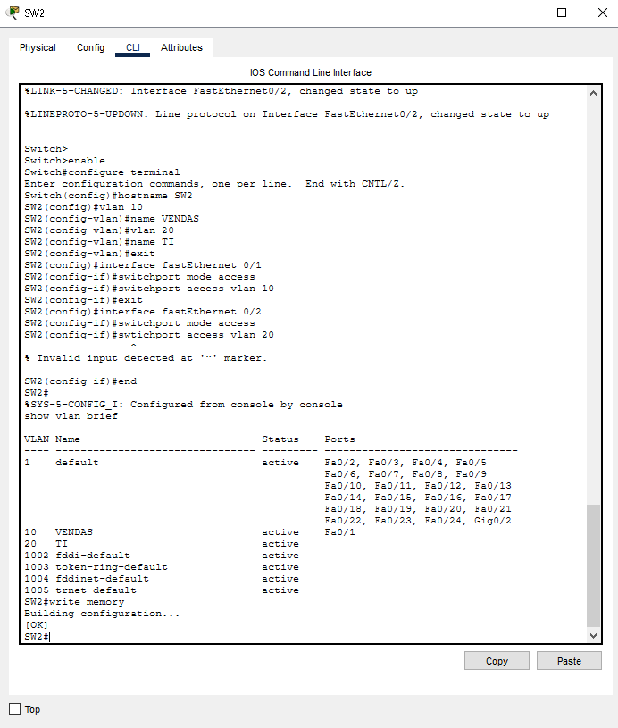
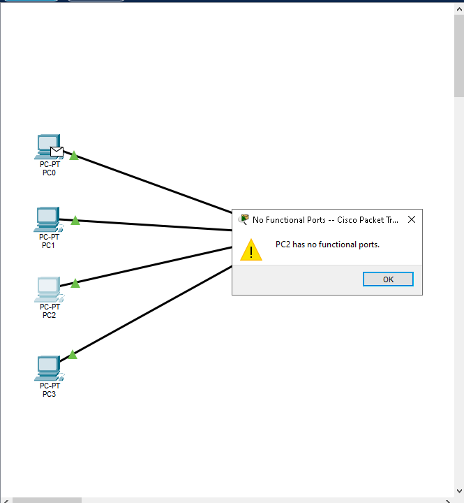
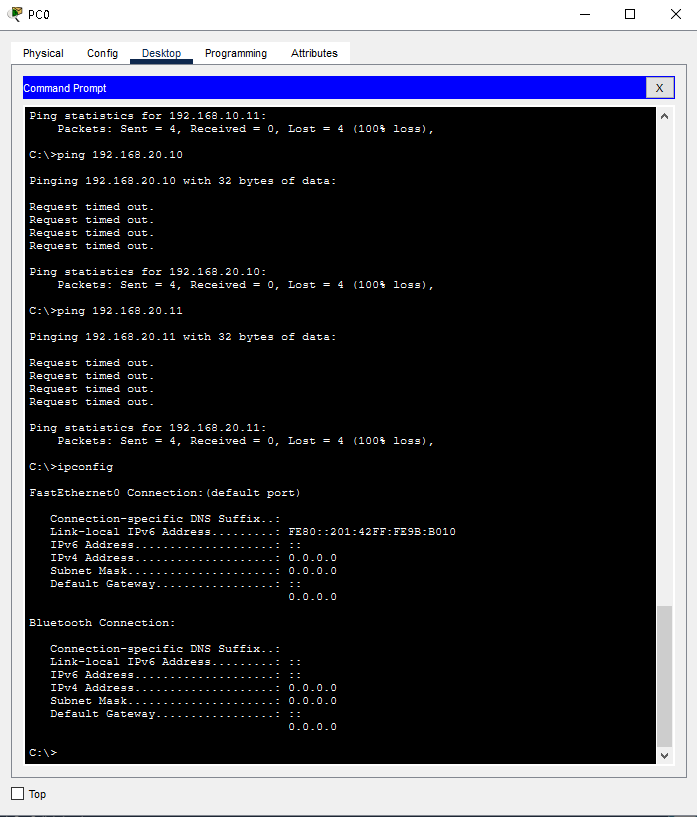

## Conclusão

- VLANs separam uma rede física em redes lógicas: mesmo ligados ao mesmo switch, PCs de VLANs diferentes não se enxergam.
- A VLAN é local de cada switch: precisa ser criada nos dois, e a porta do PC precisa estar na VLAN certa (`switchport access vlan N`).
- O trunk leva várias VLANs por um único cabo entre switches, marcando os quadros com 802.1Q. Sem ele, PCs da mesma VLAN em switches diferentes não conversam.
- Para dois PCs conversarem sem roteador, é preciso mesma sub-rede **e** mesma VLAN.
- Para conversar entre VLANs diferentes, é preciso um roteador (ou switch de camada 3): fica para o Lab 03.
- Ao diagnosticar: conferir IPs, depois se a VLAN existe nos dois switches, depois a VLAN de cada porta, depois o trunk (`show interfaces trunk`) e, por fim, procurar `% Invalid input` nos comandos digitados.

## Arquivos

| Arquivo | Descrição |
| --- | --- |
| `lab02-vlans.pkt` | Arquivo do Packet Tracer (copiar para esta pasta) |
| `img/` | Prints usados neste relatório |
